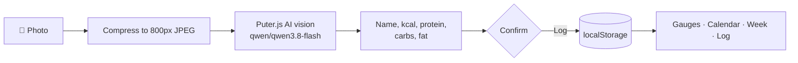

<div align="center">


**Snap a photo of your meal. Get calories and macros in seconds.**

An installable, single-file web app for tracking calories and protein, with an underwater theme, animated gauges and AI food recognition.

<p>
  
  
  
  
  
</p>

<p>
  
  
  
  
  
</p>

[Features](#-features) · [How it works](#-how-it-works) · [Getting started](#-getting-started) · [Tech stack](#-tech-stack) · [Roadmap](#-roadmap)

</div>

---

## ✨ Features

### 📸 AI meal scanning
Take a photo or pick one from your gallery. The AI estimates the **food name, calories, protein, carbs and fat**, shows an animated result card, and lets you confirm before it is logged. Photos are compressed on-device before upload.

### 🎯 Personalised targets
A guided onboarding (age, sex, height with an interactive slider and stick figure, weight, goal, timeline, activity level) calculates your daily calorie and protein goals. Edit your data at any time from the ⚙️ menu.

### 📊 Live gauges
Two analog dials for **calories** and **protein** with a moving needle and an auto-scaled tick ring. They turn teal when you hit your target and red when calories go over.

### 📅 Calendar and weekly view
A monthly calendar shows which days you logged and how each day went against your goal. Tap a day to open its full meal log. A weekly chart sits beside it; swipe between the two.

### 🥣 Meal log
Entries show a thumbnail and macro chips. Tap a card for details, or use the ⋮ menu to **edit** or **delete**. The 📋 menu switches the list between today, this week, this month, the last 6 months and the last year.

### 🎬 Details that delight
- 🌊 An animated dive from the sky into the ocean when the app opens (GSAP).
- 🫧 Dumbbell-in-bubble shapes drift up behind the app.
- 🗑️ Deleting a meal sucks it into a red neon bin, genie-style, with a sound.
- 🦖 A little dino runs while the AI works, then sprints off when the scan finishes.
- 🍞 Floating in-app toasts replace browser alerts.
- 🔊 Sounds are generated live with the Web Audio API, so there are no audio files.

### 📱 Installable and private
Mobile-first with safe-area support and a generated "Add to Home Screen" icon. There is no account and no backend of ours: your data stays in your browser's `localStorage`.

---

## 🧠 How it works



**Goal maths** uses the Mifflin-St Jeor equation for BMR, scaled by activity level (×1.2 / 1.375 / 1.55 / 1.725) to get TDEE. For a weight goal, the gap is converted at 7,700 kcal per kg and spread over your timeline. Calories never drop below 1,200. Protein targets are 2.0 g/kg (2.2 g/kg when losing weight).

---

## 🧰 Tech stack

| Area | Choice |
| --- | --- |
| App | One `index.html`: plain HTML, CSS and JavaScript, no build step |
| Animation | [GSAP](https://gsap.com/) for the intro, Web Animations API and CSS for UI motion |
| Audio | Web Audio API, with generated sounds |
| AI | [Puter.js](https://developer.puter.com/) `puter.ai.chat` with vision (`qwen/qwen3.8-flash`) |
| Storage | Browser `localStorage` (oldest photos are dropped first if storage fills up) |

---

## 🚀 Getting started

```bash
git clone https://github.com/Danialbroz/macro-tracker.git
cd macro-tracker
```

Open `index.html` in a browser, or serve the folder:

```bash
npx serve .
```

On your first scan, Puter asks you to sign in. No API key to set up. You can change account later from **⚙️ → Switch Puter account**.

> GSAP and Puter.js load from CDNs, so you need an internet connection.

---

## 📖 How to use

1. Complete the short onboarding to set your goal.
2. Tap **Scan Meal with AI**, take or choose a photo, and confirm the result.
3. Watch the gauges fill through the day.
4. Open the calendar or week view to review past days.
5. Edit or delete entries from the ⋮ menu on any card.

---

## 🔐 Privacy

- Your profile, goals and meal logs live only in your browser.
- Scanned photos are sent from your device to Puter's AI service for analysis.
- Clearing site data erases your history. There is no export yet.

---

## 🗺️ Roadmap

- [x] AI meal scanning
- [x] Personalised calorie and protein goals
- [x] Calendar and weekly history
- [x] Edit and delete meals
- [ ] Export and import your data
- [ ] Manual food search and barcode scanning
- [ ] Carbs and fat targets
- [ ] Offline support (service worker)

---

## 🤝 Contributing

Ideas and pull requests are welcome. Open an issue first to discuss larger changes.

## 👤 Author

**Muhammad Danial bin Zainal Abiddin**: [@Danialbroz](https://github.com/Danialbroz)

---

<div align="center">

Made with 💙 and a lot of bubbles.

⭐ Star the repo if you like it.

</div>
